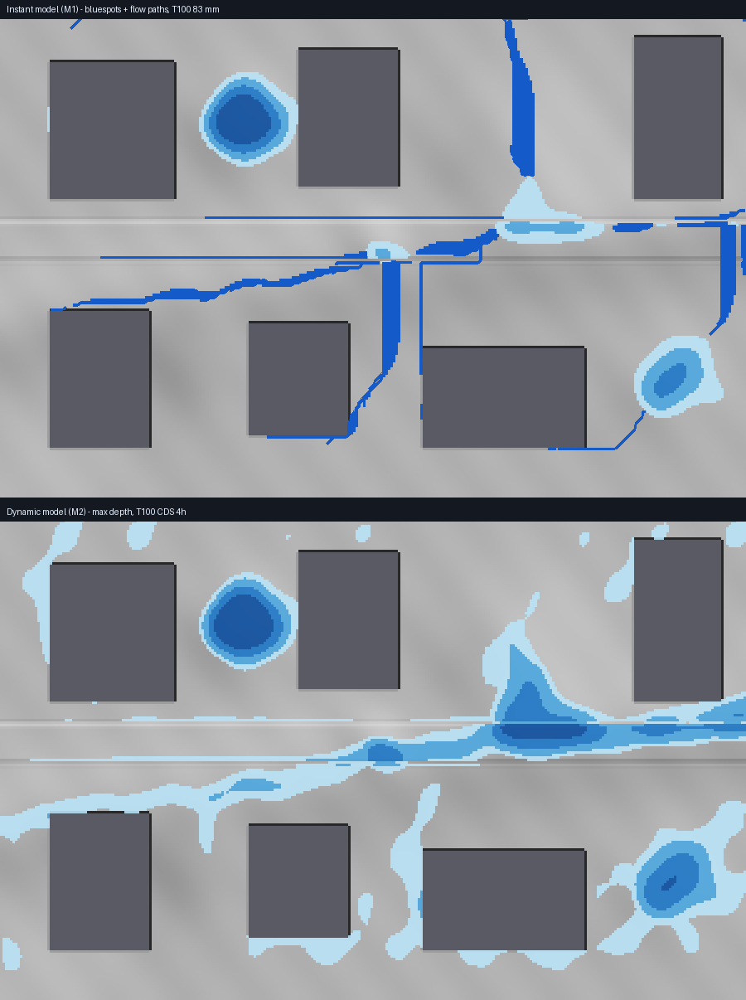

# Cloudburst – rainwater screening for Rhino 8, Grasshopper and Revit 2026

Shows designers where rainwater flows and ponds on a site during a cloudburst, and how a design change alters that —
inside the modelling tool, in seconds. Built from [docs/PRD.md](docs/PRD.md).

> **Screening model.** Results are for design comparison, not for permit or compliance evidence. Every map says so.

## Architecture

```
Shared/
  cloudburst-core/        Rust engine (all calculations), C ABI → cloudburst_core.dll / .so / (wasm later)
    src/grid.rs             site → raster: terrain, design terrain, buildings (+5 m blocks), kerbs/channels,
                            bridge cut-outs, materials, JB soils, sewer zones          (IN-1…IN-6)
    src/instant.rs          M1: priority-flood bluespots, fill–spill cascade, MFD flow paths   (< 0.4 s / 1 M cells)
    src/dynamic.rs          M2: local-inertial 2D shallow water (Bates 2010 / de Almeida 2012), rayon-parallel,
                            rain-on-grid, initial-loss bucket, modified Horton, sewer loss, mass balance
    src/rain.rs             indicative Danish IDF, CDS (alternating block), box rain
    src/retention.rs        reduced area, rational peak, required storage                       (OUT-8)
    src/ffi.rs              C ABI used by .NET
    tests/, examples/bench  validation + performance (cargo test / cargo run --example bench)
  Cloudburst.Net/         .NET wrapper (P/Invoke), host-neutral SiteModel, palette, rain presets, result visuals,
                          option comparison, demo site, ICloudburstHost (the contract every CAD host implements)
  Cloudburst.Net.Tests/   end-to-end tests C# → Rust (run on Linux CI)
  Cloudburst.UI/          shared WPF panel used by both Rhino and Revit
  Cloudburst.Standalone/  (optional) the UI with a fake host — demo without CAD
Rhino/
  Cloudburst.Rhino/       Rhino 8 plug-in (.rhp): `Cloudburst` command opens the panel; RhinoHost; display conduit
  Cloudburst.Grasshopper/ Grasshopper components (.gha): Grid, Materials, Rain, Solve Instant/Dynamic, Results, Compare
Revit/
  Cloudburst.Revit/       Revit 2026 add-in: ribbon + dockable pane; RevitHost via ExternalEvent; DirectShape results
```

One engine, three front-ends. The Rust core has no CAD dependencies, so the same crate can later be compiled to
WebAssembly or wrapped in a small server for a web viewer.



*Built-in demo site (300 × 200 m, 1 m grid, T = 100 CDS 83 mm). Top: instant model (bluespots and flow paths, 20 ms). Bottom: dynamic model max depth (4.5 h simulated in 42 s on 4 cores, mass error 3e-6). Rendered straight from engine output.*

## Build

Windows (produces `dist/`):

```powershell
./build.ps1
```

Linux / CI (cross-compiles the Windows DLL with mingw and runs all tests):

```bash
./build.sh
```

Tests only:

```bash
cd Shared/cloudburst-core && cargo test --release
```

```bash
dotnet test Shared/Cloudburst.Net.Tests
```

Performance check:

```bash
cd Shared/cloudburst-core && cargo run --release --example bench
```

## Debugging from Visual Studio (F5)

Open `Cloudburst.sln` (VS 2022 17.8+, .NET 8 SDK). Rust is optional, because a prebuilt engine is in
`Shared/cloudburst-core/prebuilt/win-x64/`. If you change the Rust code, run `cargo build --release` in
`Shared/cloudburst-core` and the build picks up `target/release/cloudburst_core.dll` instead.

| Startup project | Launch profile | What happens |
| --- | --- | --- |
| `Cloudburst.Rhino` | **Rhino 8** | Starts Rhino 8 (`/netcore`). `RHINO_PACKAGE_DIRS` points at `Rhino/dist/Debug/`, where every build copies the .rhp, .gha and DLLs. Type `Cloudburst`. |
| `Cloudburst.Rhino` or `Cloudburst.Grasshopper` | **Rhino 8 + Grasshopper** | Same, and opens Grasshopper (components under the *Cloudburst* tab). |
| `Cloudburst.Revit` | **Revit 2026** | A Debug build writes `%AppData%\Autodesk\Revit\Addins\2026\Cloudburst.Debug.addin`, which points at `bin\Debug\…\Cloudburst.Revit.dll`, so nothing is copied and breakpoints just work. |
| `Cloudburst.Standalone` | (default) | The shared panel and a 2D map without any CAD app. This is the fastest UI loop. |

Notes:
* If Rhino doesn't pick the plug-in up from `RHINO_PACKAGE_DIRS`, drag `Rhino/dist/Debug/Cloudburst.Rhino.rhp` into Rhino once.
  Rhino remembers that path, and later builds overwrite the file there.
* Don't install the release Revit add-in (`install.ps1`) while debugging. Both register the same dockable pane.
  Delete `Cloudburst.Debug.addin` to stop loading the debug build.
* Revit and Rhino lock the DLLs while running, so close them before rebuilding.
* The launch profiles assume the default install paths (`C:\Program Files\Rhino 8\…`, `C:\Program Files\Autodesk\Revit 2026\…`).
  Edit `Properties/launchSettings.json` if yours differ.

## Install

* **Rhino 8**: drag `dist/Rhino/Cloudburst.Rhino.rhp` into Rhino, run `Cloudburst`. Grasshopper: copy
  `Cloudburst.Grasshopper.gha` *and the DLLs next to it* into the Grasshopper Libraries folder (or add `dist/Rhino` as a
  library folder). See [Rhino/README.md](Rhino/README.md).
* **Revit 2026**: copy `dist/Revit/Cloudburst.addin` and the `dist/Revit/Cloudburst/` folder to
  `%AppData%\Autodesk\Revit\Addins\2026\`. See [Revit/README.md](Revit/README.md).

## Validation status (automated)

| Test (PRD) | Where | Status |
| --- | --- | --- |
| Lake at rest | `dynamic::tests::lake_at_rest_stays_still` | ✅ velocities < 1e-4 m/s |
| Tilted plane vs kinematic wave | `dynamic::tests::tilted_plane_reaches_kinematic_steady_state` | ✅ within 15 % (PRD asks 5 % on outflow) |
| Rain-on-grid mass balance | `dynamic::tests::rain_on_grid_conserves_mass` + site test | ✅ error ~1e-6 (target 0.1 %) |
| Floodplain depression filling (EA Test 2 style) | `tests/benchmarks.rs` | ✅ volume conserved, flat levels |
| M1 fill–spill conservation and cascades | `instant::tests` | ✅ |
| Retention vs hand calculation | `retention::tests` | ✅ |
| EA Test 8A, SCALGO comparison | — | ⏳ needs reference data / test site |

Performance on a 4-core container: M1 1 M cells 0.31 s, 4 M cells 1.6 s. M2 ≈ 55 M cell-steps/s on CPU
(≈ 20 min for 1 M cells × 8 h on 4 cores; scales with cores). A GPU backend (wgpu compute: DX12/Vulkan/Metal and
WebGPU) is the planned next step to reach the 5-minute target.

## Assumptions taken (to confirm)

* Rhino 8 / Grasshopper and Revit 2026, Windows. The shared UI is WPF, so it runs on Windows only. The engine itself is cross-platform.
* **Engine in Rust** behind a C ABI. Multithreaded CPU solver today; GPU (wgpu) planned. The CPU fallback is therefore the default.
* Danish defaults: palette and JB soil table from the PRD, sewer initial loss 34/29 mm, climate factors 1.2/1.3/1.4.
* Rain: an indicative IDF calibrated to the PRD numbers (T10 4 h ≈ 35 mm, T100 4 h ≈ 59 mm). Replace it with Skrift 32 values for real projects.
* Boundaries: open edges use normal-depth outflow with the local slope (min 0.1 %). M1 always treats edges as outlets.
* The 2D time step uses Δt = α·Δx/√(2gh), the 2D-stable form of the PRD formula (α = 0.7 kept).
* Roofs: a building cell is a +5 m block. "To sewer" roofs lose the sewer initial loss, and the excess runs off the footprint edge.
* Results are written into the CAD model as preview geometry (Rhino display conduit, Revit DirectShapes) and can be baked.
* DHM GeoTIFF import, M3 (SWMM coupling), ensemble mode and building façade flags are not built yet.
