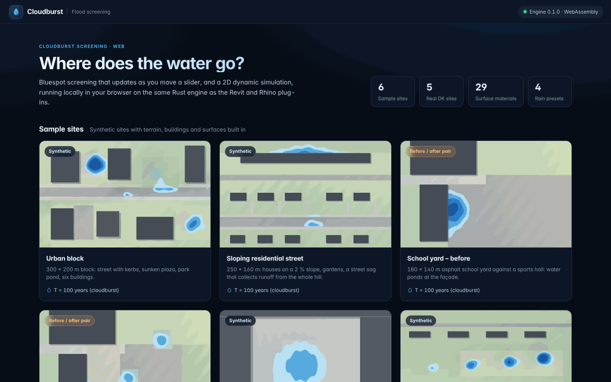
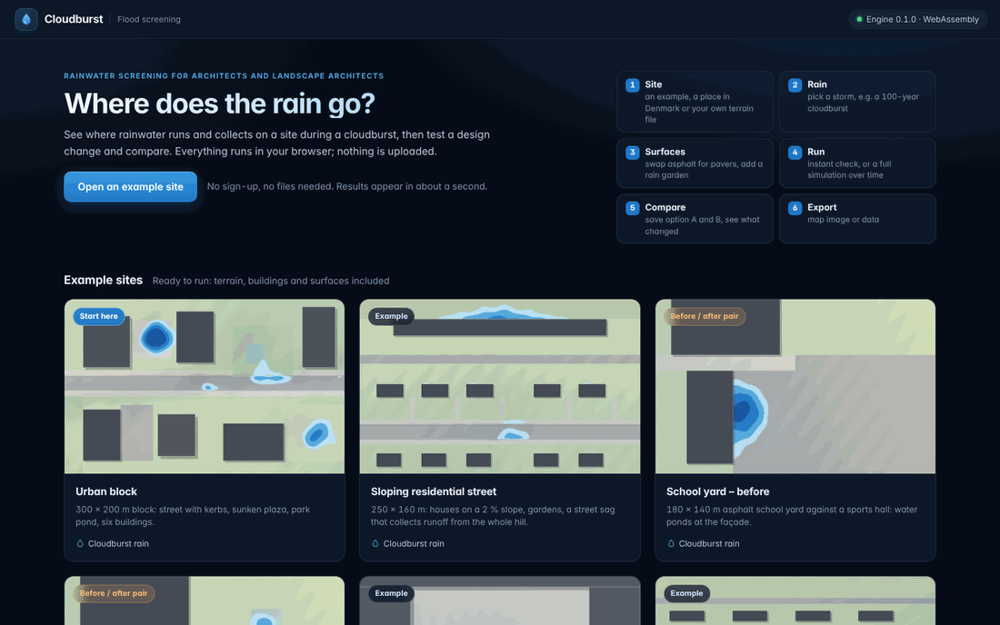
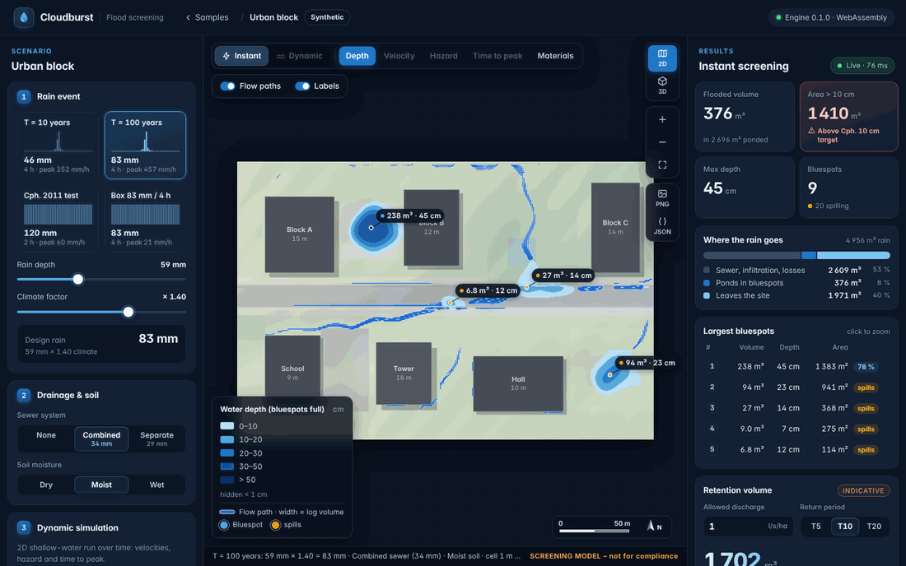
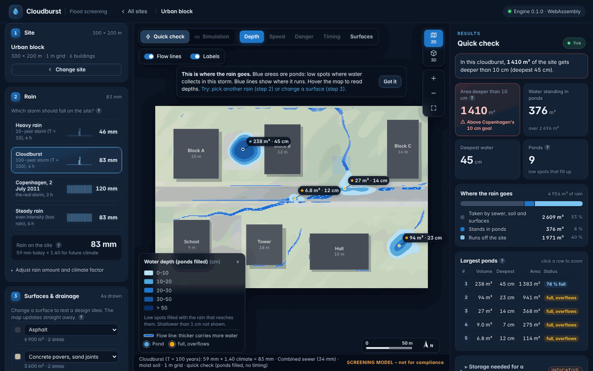
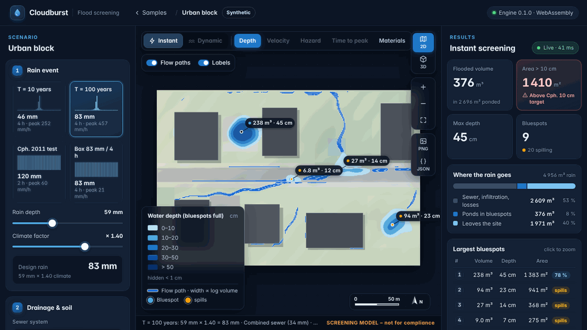
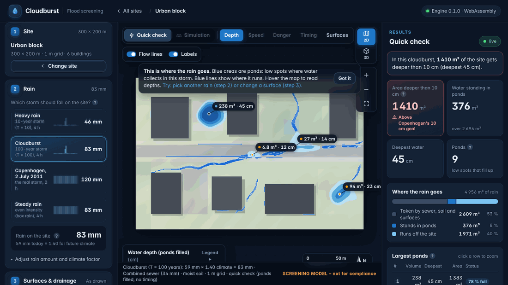
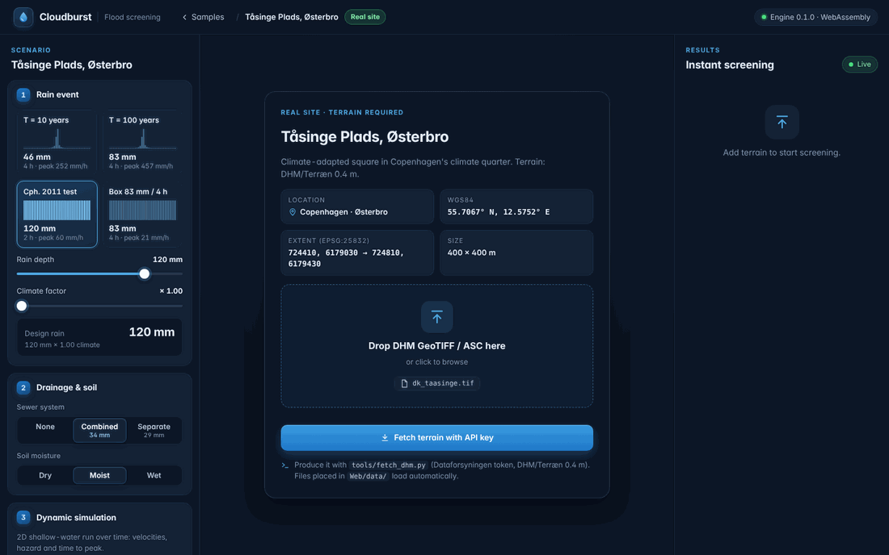
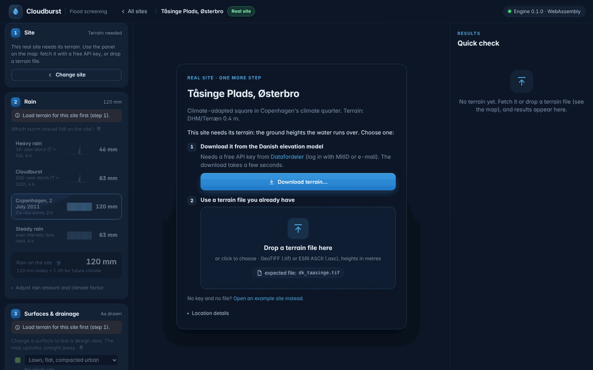
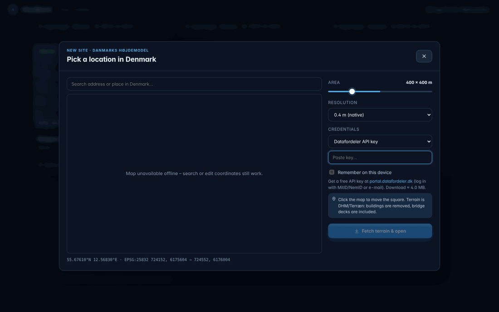
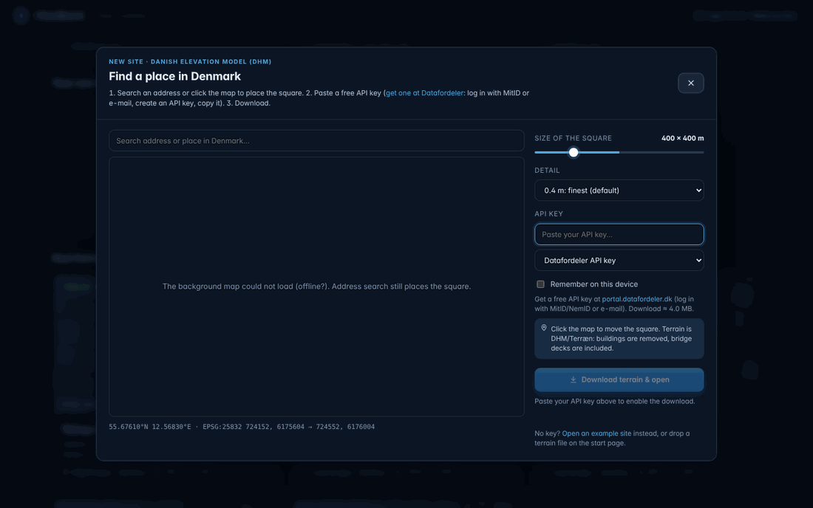

# UX review: web app first run (Nov 2026)

**Scope.** The web app (`Web/`), walked through as a new user with no documentation: an architect or landscape
architect who knows what a 100-year rain is in a meeting but not what "bluespot", "CDS" or "Manning" mean. The shared
WPF panel (`Shared/Cloudburst.UI`) was reviewed by reading only (no .NET or WPF on the review machine).

**Method.** Playwright drove `python3 Web/serve.py` (port 8123) at 1440 × 900 and at a small laptop size
(1280 × 720 and 1366 × 768), screenshotting each step of the core job: open the app, get a site (example, real
Danish site, "pick a location" up to the API key, uploaded terrain file), read the screen, set rain and surfaces, run
the quick check and the full simulation, read the result, change the design, compare option A and B, export.
The same walkthrough was re-run after the changes. Screenshots: [ux/](ux/).

**Verdict before.** The app looked finished and the engine is fast, but the screen asked the user to already know the
method. Three columns of controls with no order; the one thing a designer comes for (change a surface, compare) was
not possible in the web app at all; every number and layer was named in hydrologist vocabulary.

| Before | After |
| --- | --- |
|  |  |
|  |  |
|  |  |
|  |  |
|  |  |

More after-shots: [surfaces step with a swapped material](ux/after-surfaces.png),
[A vs B compare](ux/after-compare.png), [full simulation done](ux/after-simulation.png).

---

## Findings, ranked by severity

Severity: **S1** the user cannot complete the core job · **S2** the user stalls or misreads a result · **S3** friction,
slower than needed · **S4** polish.

### S1-1 · No way to change the design in the web app — done
*What a new user sees.* A "Materials" map layer that only displays materials. The workspace offers rain, sewer and
soil moisture, nothing about the site itself. "Save as option" / "Compare last two" exist, but the only things you can
vary between options are the rain and drainage.
*Why they stall.* "Test asphalt vs permeable pavers" is the reason a landscape architect opens the tool. There is no
path to it; the compare feature looks broken because two options of the same design are near-identical.
*Fix.* New step **3 Surfaces & drainage**: every material on the site is listed (area, number of regions) with a
material picker grouped by category. Swapping one rebuilds the grid with the sample's regions re-materialised
(`site.surfaces` overrides, which the engine already supports; later regions win) and the quick check updates in
under a second, keeping the view. "Everything else" sets the ground material (`defaultMaterial`), which also makes
uploaded and DHM terrain usable (it was locked to lawn). **Reset surfaces** undoes all swaps. The swaps flow into the
full simulation, the stale-run warning, the caption, option names and exports.

### S1-2 · No visible order of work — done
*Sees.* Left: "1 Rain event, 2 Drainage & soil, 3 Dynamic simulation". Right: results, retention, options. Map rail:
PNG / JSON icons. No Site, Compare or Export steps.
*Stalls.* Nothing says what to do next or where comparing and exporting live; "Save as option" sits under the
retention calculator at the bottom of the results column.
*Fix.* The left panel is now the job in six numbered steps: **Site → Rain → Surfaces & drainage → Run → Compare designs
→ Export**, each with a one-line summary in its header ("83 mm", "1 change", "2 saved"). The results column ends with
a "Next:" line that points to the next step. The start page shows the same six steps.

### S1-3 · Real Danish sites are a dead end without an API key — done (wording, routing)
*Sees.* Five attractive "Real site" cards on the start page. Opening one shows a GeoTIFF drop zone, a "Fetch terrain
with API key" button and a developer hint about `tools/fetch_dhm.py`. The left panel shows fully active rain/drainage
controls that do nothing.
*Stalls.* The cards look like examples; the key requirement appears only after clicking; nothing offers a way out.
*Fix.* Cards say **"Real site · needs terrain"** and the section header says why. The site page explains what
terrain is and offers two numbered choices (download with a free key, with a link and how long it takes; or drop a
file), plus "No key and no file? Open an example site instead". Location details and the developer hint are folded
into "Location details". Steps 2–6 show "Load terrain for this site first (step 1)" and are inert until then. The
results column says what will appear and how.

### S2-1 · Jargon everywhere — done
*Sees.* Bluespots, spills, T = 100, Cph. 2011 test, Box 83 mm / 4 h, climate factor, combined 34 mm, soil moisture,
Instant / Dynamic, Velocity, Hazard h·(v+0.5), Time to peak, Max envelope, mass balance, left boundary, initial loss,
reduced area, box rain method, critical duration, l/s/ha, T5/T10/T20, cell size.
*Fix.* Plain names first, the technical term second and still visible (experts keep their vocabulary):
"Cloudburst — 100-year storm (T = 100)", "Heavy rain", "Copenhagen, 2 July 2011", "Steady rain (box rain)";
"Ponds" (bluespot in the help), "full, overflows"; "Quick check" / "Simulation"; layers **Depth / Speed / Danger /
Timing / Surfaces**; "Where the rain went" with "Soaked into the ground", "Into the sewer", "Ran off the site edge";
"Book-keeping error"; "Deepest overall". The unavoidable terms get a focusable **?** with a one-sentence explanation;
all wording lives in `Web/js/terms.js` so it stays consistent. The hover tooltip on the map uses the same words
("Danger to people: caution (0.62)").

### S2-2 · Results without a takeaway — done
*Sees.* Four tiles (Flooded volume, Area > 10 cm, Max depth, Bluespots 9 / "20 spilling" — more spilling than there
are bluespots, because the tile counts only ponds above 1 m³).
*Stalls.* Which number matters? Is 1 410 m² good or bad?
*Fix.* A one-sentence verdict on top ("In this cloudburst, 1 410 m² of the site gets deeper than 10 cm (deepest
45 cm). About X m² is dangerous to wade through."), the Copenhagen 10 cm goal tile first, the confusing spill count
removed from the tile (it is still in the pond table per pond). In compare, the verdict lists what changed in B
("Option B has 322 m² less area deeper than 10 cm, 84 m³ less water standing in ponds and 79 m³ less water running
off the site"), and says so plainly when the quick check shows no difference.

### S2-3 · Compare: hard to reach, ambiguous options, silent "no change" — done
*Sees.* "Compare last two" disabled with no reason; options named "Urban block – A: T = 100 years (cloudburst),
combined", truncated so A and B read the same; a difference map that is simply empty when nothing changes by 1 cm.
*Fix.* Step 5 guides through it ("Save what you see now as option A. Then change … and save option B"), the button
reads "Save as option A/B/C", and "Compare A and B" appears once there are two. Option names lead with the design
difference ("Option B: Asphalt → Permeable pavers · Cloudburst, combined sewer"). The difference legend says when no
spot changed by 1 cm and points to the numbers. Removing an option offers **Undo**. Compare opens on "What changed"
(difference map); "Side by side" is the swipe. While comparing, the left panel shows only Compare and Export, with
"Back to editing".

### S2-4 · Full simulation: estimate off by 2×, progress out of sight — done
*Sees.* "Estimated ≈ 30 s"; the run took 55 s. The progress card sits at the bottom of the left panel, below the fold
at 900 px height; the map gives no sign anything is running.
*Fix.* A progress pill with **Cancel** over the map whenever a simulation runs. The estimate is rounded ("about 30 s")
and recalibrated from the last run on this computer. After the run, a toast and the step say what is new ("Speed,
danger and timing are on the map"); if settings change afterwards, the button becomes "Run again with new settings"
and a note explains that the simulation shows the old design. Cancel says the earlier results are unchanged. Failures
suggest a coarser cell size.

### S2-5 · Rain: two numbers that disagree — done
*Sees.* Picking "T = 100 years" shows 83 mm on the card, but the "Rain depth" slider says 59 mm, next to a "Climate
factor" slider.
*Fix.* One number up front, "Rain on the site 83 mm — 59 mm today × 1.40 for future climate", with a help mark. The
two sliders moved under "Adjust rain amount and climate factor" with the climate explanation inline.

### S2-6 · Disabled controls without a reason — done
*Sees.* Dimmed "Dynamic", "Velocity", "Hazard", "Time to peak" with a browser title tooltip at best; "Fetch terrain &
open" disabled with no text.
*Fix.* Every disabled control says why and where to go: tooltips ("Needs the full simulation (step 4)"), a click
toasts the reason and flashes step 4; the DHM dialog shows "Paste your API key above to enable the download."

### S2-7 · "Pick a location" dialog — done (as far as it goes without a key)
*Sees.* Key field half-way down, no explanation of where the key comes from until the small print; offline the map
says "search or edit coordinates still work" but there is no coordinate field; a rejected key shows the raw server
message.
*Fix.* A three-step intro under the title (place the square, get a key with a link and the steps, download), "API
key" placed first in the credentials, honest offline text, a plain message for a rejected key, and a "No key? Open an
example site" exit. Not verified past the key (no key on the review machine, map tiles blocked).

### S3-1 · Start page does not say where to start — done
*Sees.* 11 site cards and four vanity stats (6 sample sites, 5 real DK sites, 29 materials, 4 rain presets).
*Fix.* One primary button, **Open an example site** ("No sign-up, no files needed"), the six-step "how it works" in
place of the stats, the first example badged **Start here**, and sources grouped as *Example sites* (ready to run),
*Your own site* (find a place / upload a file) and *Real Danish sites* (needs terrain).

### S3-2 · No orientation on the map — done
*Fix.* A first-run note over the map: "This is where the rain goes. Blue areas are ponds … Hover the map to read
depths. Try: pick another rain (step 2) or change a surface (step 3)." Dismissed with **Got it**, remembered per
browser, never blocks the map, hidden in compare.

### S3-3 · Small laptop: legend covers a third of the map, caption cut off — done
*Fix.* The legend can be collapsed and starts collapsed when the window is under 760 px tall; the caption wraps
instead of ending in "…" (the assumptions it carries are the point of it).

### S3-4 · Retention calculator in the main results — done
*Sees.* A big "1 702 m³" next to the flood results, with "T10" while the rain above is T100, and "1 l/s/ha".
*Fix.* Folded into "Storage needed for a discharge limit (indicative)" with a sentence on what it is for, labels in
words ("Allowed discharge to sewer, l/s per ha", "10-year" design storm, "Effective sealed area (C·A)", "Longest
storm to store").

### S3-5 · Export as two unlabeled icons on the map rail — done
*Fix.* Step 6 lists export actions with a sentence each ("Map image (PNG) — the current map with legend and
assumptions"), noting that every export carries the assumptions and "screening model". This is also where the report
module will plug in (see below).

### S3-6 · Engine notes shown as warnings on example sites — done
*Sees.* "No bridge cut-outs set; DHM bridge decks act as false dams. Grid 300×200 @ 1.00 m built in 2 ms." on a
synthetic site.
*Fix.* Engine notes are shown only for uploaded/DHM terrain, where the bridge warning matters; the timing line is
dropped.

### S4 · Keyboard, focus, screen readers — partly done
Done: a global `:focus-visible` ring, "Skip to steps" link, `aria-pressed` on every segmented control and toggle,
`role="radiogroup"` on the rain presets, keyboard-operable pond rows and drop zone, labelled zoom/close/remove/play
buttons, progress bar with `aria-valuenow`, toasts in a polite live region, help marks focusable and readable.
Not done: the map canvas itself has no keyboard pan/zoom or text alternative (the results column carries the same
information); contrast of muted text on the dark panels was not measured (the visual redesign will replace the
palette).

---

## Not changed on purpose

* **Visual design** (colours, type, spacing): left to the visual-redesign pass. New CSS is in one block at the end of
  `Web/styles.css` with semantic class names and no new colours.
* **Map labels overlap building names** (e.g. "238 m³ · 45 cm" over "Block B"): a `mapview.js` drawing issue, cosmetic.
* **Sample names contain jargon** ("School yard – after (LAR)"): they come from the engine's sample catalogue
  (`Shared/cloudburst-core`, physics agent's area).
* **Quick check is insensitive to some swaps.** Asphalt → permeable pavers on the street reduces runoff off the site
  (−252 m³) but not the ponds, which is the model being right, not the UI. The compare verdict now says what did
  change. Users may still expect the map to move; worth a line in a future "why didn't it change?" hint.
* **No per-region surface editing** (draw or pick one area). Swaps are per material, which covers "what if all this
  asphalt were pavers". Drawing regions belongs to the CAD hosts.
* **Report export and more terrain sources:** extension points only (below), owned by other branches.

## Extension points left for other work

* `Web/js/hooks.js`: `addSiteSource({id, title, description, icon, tag, order, open(ctx)})` renders a card in
  `#siteSources .source-cards` on the start page; `addExportAction({id, label, description, icon, primary, order,
  enabled(ctx), run(ctx)})` renders a button in `#step-export .export-actions` (primary first). The built-in DHM
  picker, file upload, PNG and JSON exports are registered the same way. `ctx` gives the app state, `captionText()`,
  `legend()`, the map, the engine and `openTerrain({bytes, info})`.

## WPF panel (`Shared/Cloudburst.UI`) — read, not run

The panel already has a six-step stepper (Site, Surfaces, Rain, Simulate, Results, Compare) with descriptions,
an "out of date" badge, a cancel button and disabled-with-reason hints ("Build the analysis grid first. Go to
Site"). Its structure is sound; its wording had the same jargon. **String-only edits, uncompiled:** step
descriptions in plain language; "Instant"/"Dynamic" → "Quick check"/"Full simulation" (titles, subtitles, run
buttons, source switch); layers Speed / Danger / Timing / Flow lines / Surfaces; "Largest ponds (bluespots)" with
"Overflows at" instead of "Spill"; "Book-keeping error" with a tooltip; plain explanations of C, n and f in the
material palette; climate-factor tooltip in words; sewer and soil-moisture labels as questions; "Show what changed
(B vs A)"; retention labels. Not touched: layout, bindings, view-model logic. Worth a follow-up on Windows: the
Rain step comes after Surfaces in the panel but before it in the web app, and the panel has no first-run guidance.

## Verification

* Re-ran the full walkthrough at 1440 × 900, 1280 × 720 and 1366 × 768 after the changes: example site → rain
  change → save A → asphalt → permeable pavers → save B → compare → PNG and JSON downloads → full simulation (ran to
  completion, ~40–60 s on the review container) → Danger layer → before/after pair compare → real site page; plus an
  uploaded ESRI ASCII terrain with a ground-material change (effective runoff lawn → asphalt 2 137 → 2 668 m³),
  option remove + Undo, and a test module registering a site source and an export action through `hooks.js`.
* Console: no errors from the app. The only entries are network failures the sandbox causes (web font and Leaflet
  from CDNs, `data/` folder listing 404 when looking for a local DHM file), identical before and after.
* Not verified: DHM download with a real key, the background map in the location dialog (tiles blocked), 3D view,
  the WPF edits (no .NET here).
